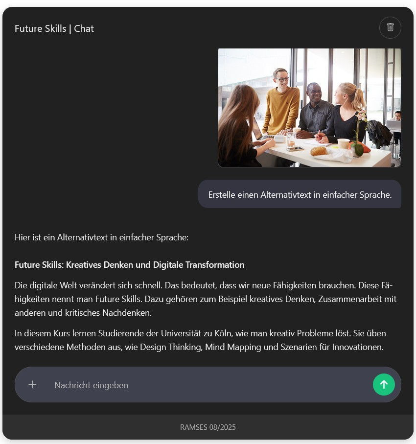
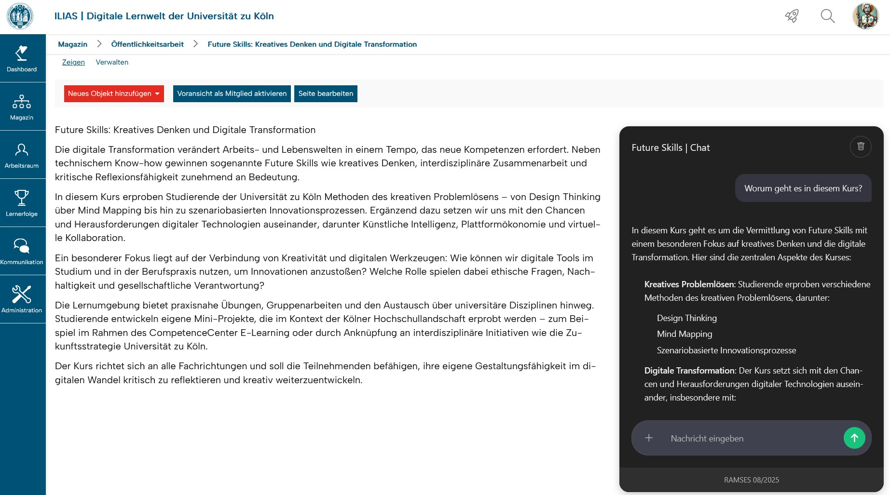
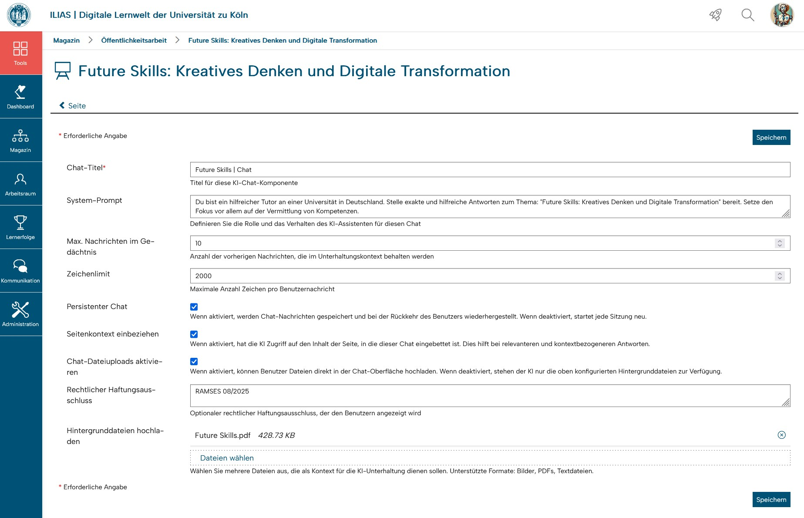
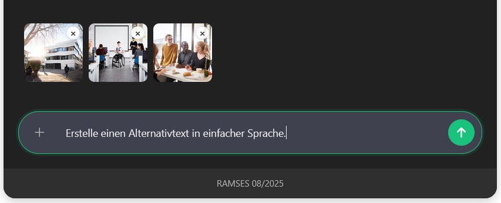

# AI Chat PageComponent for ILIAS 10

ILIAS 10 PageComponent plugin for embedding configurable AI chats into ILIAS pages. Each chat has its own system prompt, its own resources (files and the content of its page) and its own settings, so that chats can be designed for a specific teaching purpose (e.g. a tutor for a course topic or an exercise on generative AI).

The plugin talks to OpenAI-compatible chat APIs. KI:connect.nrw and OpenAI are included; further services can be added. Retrieval-Augmented Generation (RAG) is provided by a separate RAG service that can be combined with any of the AI services.

Developed by the CompetenceCenter E-Learning, University of Cologne.

## Contents

- [Screenshots](#screenshots)
- [Features](#features)
- [Requirements](#requirements)
- [Installation](#installation)
- [Updating](#updating)
- [Configuration (administrators)](#configuration-administrators)
- [Usage for editors](#usage-for-editors)
- [Usage for learners](#usage-for-learners)
- [Permissions](#permissions)
- [Data protection and data storage](#data-protection-and-data-storage)
- [How it works](#how-it-works)
- [Adding an AI service (developers)](#adding-an-ai-service-developers)
- [Adding a kind of resource (developers)](#adding-a-kind-of-resource-developers)
- [Troubleshooting](#troubleshooting)
- [License and contact](#license-and-contact)

## Screenshots


*Chat interface*


*Chat embedded in an ILIAS page*


*Chat settings for editors*


*File upload with preview*

## Features

**Chats on ILIAS pages**
- Any number of chats per page, each with its own configuration
- Supported page types: container pages (course, group, category, folder), learning modules, wiki pages, blog postings, question pools, SCORM editor pages, content pages, login pages and the imprint
- Per chat: title, system prompt, disclaimer, online/offline status
- Resources per chat: uploaded files and a snapshot of the page content, each included or excluded individually and updated on request

**AI services**
- KI:connect.nrw and OpenAI included; any OpenAI-compatible API can be used via the KI:connect.nrw service or added as a separate service
- Default AI service for all chats, optionally enforced
- Model list is loaded from the service; administrators choose which models editors may select
- Default temperature and model per service, optionally enforced; otherwise editors can set them per chat
- Streaming of responses (can be switched off globally, per service and per chat)
- Token usage is recorded per response

**Files**
- Files as resources of a chat (added by editors) and file uploads in the chat (by learners, can be switched off)
- Text files (TXT, CSV) are passed to the AI as text
- Images (JPG, PNG, GIF, WebP) are compressed and sent to the AI as images
- PDFs are converted page by page into images (configurable number of pages)
- File handling can be switched off globally or per service; allowed file types and size limits are configurable

**RAG (Retrieval-Augmented Generation)**
- Separate RAG service, usable with every AI service
- Files are stored in the RAG; for each question only the relevant excerpts are passed to the AI
- Sources are shown below the answer and as inline references; per resource with passages, with the name only or not at all, files optionally for download
- Retrieval errors are reported to learners with a clear message

**Conversation**
- Chat history per user and chat, optionally persistent across visits
- Configurable number of previous messages sent as context
- Markdown rendering of answers, also while streaming: tables (scrollable, copy, CSV export), code blocks with syntax highlighting and copy button, formulas (LaTeX via KaTeX), highlight boxes (`> [!NOTE]`, `[!TIP]`, `[!IMPORTANT]`, `[!WARNING]`, `[!CAUTION]`)
- Copying of answers, regenerating the last answer, clearing the chat
- While a long answer is streamed, the view only follows if the user is at the end of the messages; when scrolled up, a button jumps to the latest message
- Light and dark mode

**Operation**
- Statistics tab listing all chats (sessions, messages, last activity) with actions: open page, set online/offline, clear history, delete chat
- Daily message limit per user and chat
- Automatic deletion of inactive sessions after a configurable number of days
- Optional use by anonymous (not logged-in) users without storing their messages
- ILIAS export/import and copying of pages including chat configuration and resources
- German and English user interface

## Requirements

- ILIAS 10.x
- PHP 8.2 or 8.3 with `curl`, `gd` and `imagick`
- MySQL 8.0 or MariaDB (as supported by ILIAS 10)
- Ghostscript (used by ILIAS to convert PDF pages to images)
- Access to at least one OpenAI-compatible chat API (e.g. KI:connect.nrw or OpenAI)
- Optional: a RAG service compatible with the OSKI RAG WebGateway API (see [RAG](#rag-tab))

The plugin does not require other ILIAS plugins.

## Installation

1. Clone the plugin into the ILIAS directory:
   ```bash
   mkdir -p public/Customizing/global/plugins/Services/COPage/PageComponent
   cd public/Customizing/global/plugins/Services/COPage/PageComponent
   git clone -b release_10 https://github.com/cce-uzk/AIChatPageComponent.git AIChatPageComponent
   ```
2. In the ILIAS root directory, rebuild the artifacts and run the setup:
   ```bash
   composer du
   php cli/setup.php update
   ```
3. In **Administration > Extending ILIAS > Plugins**, install and activate **AIChatPageComponent**.
4. Configure at least one AI service (see below).

The plugin creates its database tables automatically (`pcaic_chats`, `pcaic_resources`, `pcaic_sessions`, `pcaic_messages`, `pcaic_attachments`, `pcaic_config` and helper tables).

TLS certificates of the AI services and the RAG service are always verified. If a service uses certificates that are not trusted by the system CA store, place the CA bundle as `certs/RAMSES.pem` in the plugin directory. This file is not part of the repository.

## Updating

```bash
cd public/Customizing/global/plugins/Services/COPage/PageComponent/AIChatPageComponent
git pull
cd <ILIAS root>
composer du
php cli/setup.php update
```

Then run the plugin update in **Administration > Extending ILIAS > Plugins** if ILIAS shows it as pending.

### Notes on version 1.12.0

- Files and the page content of a chat are now **resources** in a tab of their own (see [Resources](#resources)). Each existing background file becomes a resource. Its copy in the RAG service is deleted and uploaded again into a collection of its own by the next chat request or the cron job; until then answers may lack passages of these files.
- "Include page context" was replaced by the page content resource: chats that used it get a snapshot of the page content when an editor opens the resources tab. Until then they keep using the current page content.
- When a chat is created, only title, visibility and system prompt are asked for; all other settings are made afterwards in the edit form.
- 1.12.1: per resource, the display as source and the download can be restricted.

### Notes on version 1.14.3

- Fix: times shown by the plugin (last activity, state of resources, processing of files) were an hour late in winter and two hours in summer on servers whose time zone is not UTC. The plugin stores times in the time zone of the server, as ILIAS does, but read them as UTC for display.
- New: the statistics tab of a chat shows when the chat was created. The statistics of the plugin configuration show the creation in the time zone and date format of the user.
- The description of the chat behaviour no longer names the page context, which is a resource since 1.12.0.

### Notes on version 1.14.2

- Fix: system prompts longer than about 4000 characters could not be saved, although the form allows 12000. System prompt and disclaimer of a chat are now stored without this limit (database step 20). The default system prompt of the plugin configuration allows 12000 characters too.
- Fix: after saving, the counter of remaining characters showed too few and jumped up at the first input. ILIAS counts the saved text in bytes (an umlaut twice, a line break twice), the browser in characters. The counter now shows the characters left from the start, and line breaks are saved as the browser counts them.
- Fix: in the page editor, menus opened over the chat preview (e.g. the add menu of the element above) could not be used: a transparent layer of the preview with the same z-index lay above them. The preview has no layer of its own any more; a click on it still opens the chat for editing.

### Notes on version 1.14.1

- Fix: adding a learning module (or wiki) whose pages lie deep in chapters with long titles failed with "Data too long for column 'title'". The name of a stored page is now shortened to the 255 characters of the Resource Storage: the chapters between the object and the page are left out first ("Learning module › … › Page.txt"). The text of the page keeps the full path.
- A snapshot of a resource is stored completely before the previous one is replaced; if storing fails, the resource keeps its previous content. A learning module added while the error occurred may have stored only part of its pages: remove it from the resources of the chat and add it again.

### Notes on version 1.14.0

- New: material list for learners in the chat header, with the resources of the chat and the own files of the conversation (see [Usage for learners](#usage-for-learners)). It follows the settings of the resources: hidden resources and resources learners may not read are not listed, downloads and links only where allowed.
- Providers of resources have a new method `isListedForLearners()`.

### Notes on version 1.13.0

- New: file objects, whole wikis, content pages and learning modules of the environment of the chat as resources (RAG only), with a permission check for every answer.
- Internal rework for further kinds of resources (wikis, content pages and learning modules follow): every kind is a provider behind one interface. The behaviour of uploaded files and the page content is unchanged.
- New columns in `pcaic_resources` for resources taken from ILIAS objects; existing resources are not changed.

### Notes on version 1.12.2

- Copying a page element or a repository object with a chat failed since version 1.1.0 (an included file had been removed; 1.11.1 fixed only a second error) and left the copy with the chat of the original. Copies now get a chat of their own with all settings and copies of the resources.
- Copies made before still share the chat with their original: on the same page, the second chat element then does not react (sending, light/dark mode). Delete the copied chat element and copy it again, or add a new chat.

### Notes on version 1.10.0

- The processing state of RAG files is now tracked. Files uploaded before this version are checked against the RAG service on the next chat request; files whose processing failed there are uploaded again.

### Notes on version 1.9.0

- RAG is now a separate service with its own **RAG** tab. RAG settings of the former RAMSES service (application ID, instance ID, file types) are taken over. The RAG service is only enabled automatically if the former RAMSES URL did not point to the legacy RAMSES host; otherwise enter RAG URL and client key in the RAG tab. Until then, chats work without RAG.
- The RAMSES service is now labelled **KI:connect.nrw**. Its internal ID (`ramses`) and all settings remain unchanged. Adjust the API URL and token to KI:connect.nrw if you still use the former RAMSES endpoint.
- When the RAG URL or client key is changed, files are uploaded to the new RAG again on next use.

## Configuration (administrators)

Open **Administration > Extending ILIAS > Plugins > AIChatPageComponent > Configure**. The configuration has the following tabs.

### General

| Setting | Description |
|---|---|
| Default system prompt, default disclaimer | Prefilled for new chats |
| Default character limit | Maximum length of a learner message |
| Default memory messages | Number of previous messages sent as context |
| PDF pages processed | Number of pages converted per PDF |
| Maximum total image data | Upper limit for image data (images, PDF pages) per request to the AI service; further images are omitted and the AI service is told which ones |
| Enable streaming responses | Global switch for streaming |
| Max. messages per user/day/chat | Daily limit for logged-in users, `0` = unlimited |
| Clean up inactive sessions after (days) | Sessions without activity are deleted including messages and attachments, `0` = off |
| Default AI service / Force default AI service | Service for new chats; if forced, all chats use it and editors cannot choose |
| Maximum file size, attachments per message, total upload size | Upload limits for chat uploads, checked in the browser and on the server |
| Enable file handling for AI | Global switch; includes allowed file types and separate switches for files of resources (background files) and chat uploads |
| Allow anonymous access | Allows use without login (see [Data protection](#data-protection-and-data-storage)) |

### AI service tabs (KI:connect.nrw, OpenAI)

Each AI service has its own tab with the same structure:

| Setting | Description |
|---|---|
| Enable service | Makes the service available |
| Display name | Name of the service in the configuration tabs and in the service selection of chats. The built-in names (KI:connect.nrw, OpenAI GPT) describe the default endpoints; set a name if another OpenAI-compatible provider is configured in the tab. Internal IDs and settings are not affected |
| API base URL | e.g. `https://chat.kiconnect.nrw/api/v1` or `https://api.openai.com`; URLs with or without `/v1` are accepted |
| API token | Token of the service |
| Default model / Force default model | Default model; if forced, editors cannot choose a model |
| Models available to editors | Models that editors may select per chat (see below) |
| Default temperature / Force default temperature | Default temperature; if forced, editors cannot change it |
| Enable streaming | Streaming for this service |
| Enable file handling | File handling for this service |
| Allow RAG for this service | Chats of this service may use the RAG service |

Use **Refresh models** below the form to load the model list from the API.

**Models available to editors.** The model endpoints of the APIs do not state whether a model is a chat model. After a refresh, models whose name indicates another purpose (embedding, reranking, speech, image, audio, realtime, transcription, moderation, instruct and codex models) are unchecked; all others are checked. Please verify the selection. New models are added automatically on later refreshes according to the same rule; models that no longer exist are removed. The default model is always available. Chats that use a model which is no longer available fall back to the default model.

**OpenAI and RAG.** "Allow RAG for this service" is off by default for OpenAI, because the retrieved document excerpts are then sent to OpenAI. Check whether this is permissible for the content concerned before enabling it.

For reasoning models (OpenAI o-series and GPT-5, except the GPT-5 chat variants) no temperature is sent, as these models only accept their default.

### RAG tab

The RAG service stores files and retrieves the passages relevant to a question. The answer itself is generated by the AI service of the chat.

| Setting | Description |
|---|---|
| Enable RAG service | RAG is only available if enabled and URL and client key are set |
| RAG URL | Base URL of the RAG WebGateway |
| Client key | Tenant-specific key of the RAG. The tenant is derived from the key; tenant ID or name are not entered in the plugin |
| Application ID, Instance ID | Used to form the collection names within the tenant (converted to numbers internally) |
| RAG allowed file types | File types uploaded to the RAG; other types are sent to the AI directly |
| Maximum number of excerpts | Maximum number of passages per question (`top_k`, default 10) |

The plugin uses the following endpoints of the RAG WebGateway, all with `Authorization: Bearer <client key>`:

| Endpoint | Purpose |
|---|---|
| `POST /v1/rag/upload` | Upload a file into a collection |
| `POST /v1/rag/delete` | Delete a file |
| `POST /v1/rag/augmentation` | Retrieve passages for a conversation (no answer generation) |

If URL or client key are changed, the stored references to RAG files are reset, because the collections belong to the previous RAG or tenant. Resources are then uploaded again automatically when the chat is next used.

### Statistics tab

Lists all chats with page, number of sessions and messages, last activity and RAG usage. Available actions: open the page, set online/offline, clear the chat history (all sessions), delete the chat completely, and delete inactive sessions now.

The statistics tab of a chat (edit mode) lists its files with their processing state in the RAG service; it is kept as an overview for administrators while the resources tab is introduced.

## Usage for editors

### Adding a chat

1. Edit an ILIAS page.
2. Insert the **AI Chat** element.
3. Enter a title, the visibility (offline by default) and a system prompt and save. The edit form opens, where all further settings are made.

### Chat settings

The edit form has the tabs **Settings**, **Resources**, **Advanced settings** and **Statistics**.

| Tab | Setting | Description |
|---|---|---|
| Settings | Chat title, online | Title shown above the chat; offline chats are not shown to learners |
| | System prompt | Role and behaviour of the AI |
| | Persistent chat | Keeps the history when learners return |
| | Enable chat file uploads | Learners may attach files |
| | Enable streaming | Answers appear while they are generated |
| | Use RAG mode | Uses the RAG service for the resources and chat uploads (see below) |
| | Show sources, allow source downloads | Only in RAG mode; can be restricted per resource |
| | Disclaimer | Text shown with the chat |
| Resources | | Files and page content the chat uses (see below) |
| Advanced settings | AI service, model, temperature | Only shown if not enforced by the administrator |
| | Max memory messages, character limit | Context size and maximum message length |

Settings that the administrator has disabled or enforced are shown as disabled fields.

### Resources

Resources are what a chat uses besides the conversation. Editors add them actively in the **Resources** tab; the chat never picks up content on its own.

| Resource | Content |
|---|---|
| File | An uploaded file (allowed types depend on the AI service and the RAG service). Each file is a resource of its own |
| Page content | The visible text of the page containing the chat (paragraphs, without embedded files or sub-objects) |
| File object (RAG only) | A file object of the environment of the chat (the course, group or folder containing the page, and its folders), as copy of its current version |
| Wiki (RAG only) | A whole wiki of the environment, or the wiki containing the page: one text file per active page, named "Wiki › Page"; at most 500 pages. Offered only if TXT is a RAG file type |
| Content page (RAG only) | A content page of the environment as one text file |
| Learning module (RAG only) | A learning module of the environment: one text file per active page in the order of its chapters, named "Learning module › Chapter › Page"; pages outside the chapters and deactivated pages are left out |

- A resource is a **snapshot** from the time it was added or updated. Changes of the page only reach the chat with **Update** (shown with the date of the snapshot). An updated snapshot replaces the previous one, also in the RAG service.
- **Use / Do not use** excludes a resource without removing it; it stays in the RAG service and can be included again at once.
- **Remove** deletes the resource including its copy in the RAG service.
- **Add from the environment** (RAG only) offers the file objects, wikis, content pages and learning modules of the environment that the editor may read and the RAG service can take. Each becomes a resource of its own.
- In the source list, pages of these objects are named "Object › Page" and show the icon ILIAS shows for the object.
- For resources taken from an object, the table shows when the source changed ("New state available"), is gone ("Source not available") or the chat was moved to another environment ("No longer in the environment"). Nothing is updated on its own; gone and moved sources are no longer used.
- Learners only get content of such a resource, in answers and in the source list, while they may read the object themselves (permission, online status, availability). Downloads of these sources link to the object in ILIAS.
- When a course is copied, the resources of its chats point to the copied objects; sources that were not copied along are no longer used.
- **As source** and **Download / link** restrict how the resource is shown below answers (see [In RAG mode](#with-and-without-rag)). New resources start with the defaults of their kind: the page content is named only and offers nothing, files and objects are shown with their passages and offer their download or link.
- The column *Processing* shows the state in the RAG service, or "Sent to the AI directly" without RAG.
- Resources are copied with the chat and included in the ILIAS export.
- Learners see the resources in the **material list** of the chat (see [Usage for learners](#usage-for-learners)): only resources shown as source at least by name, that they may read and that can contribute to answers. Hidden resources are never listed but still used. The page content is not listed. Whether a resource can be opened there follows **Download / link**, as in the source list.
- Further kinds of resources (blog, glossary, weblink collection, mediacast) are planned; they will only be available with RAG and with a permission check.

### With and without RAG

**Without RAG** all included resources are sent to the AI with every question: text files and the page content as text, images and PDF pages as images. This works well for a few short documents, but increases token usage with every message; PDF pages beyond the image data limit are omitted.

**With RAG** resources of the RAG file types are uploaded to the RAG service, each into a collection of its own. For each question only the relevant passages are retrieved and passed to the AI. This is suitable for larger amounts of text. Files of other types are sent directly. Whether images go to the RAG service or to the AI directly is decided by the file type lists of the configuration.

In RAG mode:
- With "Show sources", references such as `[1]` appear in the answer and the sources (file name, pages, excerpt, or link for web sources) are listed below it.
- With "Allow source downloads", learners can download the cited files of resources. Access to the file is checked against the read permission of the page.
- Per resource, the resources tab restricts these settings further (a resource can never allow more than its chat):
  - **As source**: *with passages* (default), *name only* (file name and pages, no passages and no download, e.g. for solutions) or *not shown* (no entry in the source list, its citations are removed from the answer; the content is still used for answers).
  - **Download**: allowed (default) or not; only for files shown with their passages. The page content is never offered for download.
  - The settings apply to the source list when it is sent to the browser, so they also apply to earlier answers. Downloads are checked on the server. Chat uploads of learners are not resources and follow the settings of the chat.
- If the RAG finds no relevant passages, the AI answers without them and is instructed not to guess the content of the documents.
- The RAG service requires a citation for every statement and always returns the most similar passages, even if none of them is relevant to the question. The plugin therefore adds the following rule to the system prompt of RAG answers (constant `RAG_CITATION_INSTRUCTION` in `AIChatPageComponentLLM`):
  > Citation rules for the provided context: Cite a context item only where the statement is actually based on that item, using the citation format specified in the context instructions. Do not add citations to statements that are not derived from the context. If none of the context items is relevant to the question, answer without citations and without referring to the context.
- The RAG processes uploaded files asynchronously; large PDFs can take several minutes. While resources are not yet processed or their processing failed, learners see a note below the answer that the answer may be incomplete.
- The processing state is queried from the RAG service by chat requests and by the cron job "AI Chat: process files in the document search" (Administration → System Settings and Maintenance → Cron Jobs; activated automatically, every minute by default, limited by the interval of the ILIAS cron call). Without the cron job, states only advance when a chat is used.
- The state of a chat is queried at most every 5 seconds in the first minute after an upload, every 30 seconds in the first 10 minutes and once per minute afterwards, so the number of concurrent learners does not increase the load on the RAG service.
- Files whose upload or processing failed are uploaded again with increasing delay (30 seconds, doubled after each failure, at most 5 minutes). A file the RAG service fails to process 5 times in a row, or whose upload it rejects (HTTP 4xx except 401, 403, 408, 425 and 429), is not uploaded again; remove and re-add the file if necessary.
- The resources tab shows the processing state of each resource; the statistics tab of the chat lists the single files with details (processed, being processed, waiting, failed with the time of the next attempt, or passed directly to the AI).
- Files the RAG service cannot delete yet, because they are still being processed, are deleted later.
- If the RAG service is not available, learners see the message "Document search is currently unavailable. Please try again later."
- Chat uploads are only searched in the conversation they were sent in: files that were uploaded but never sent, and files of a cleared conversation, are not searched. Clearing the chat also deletes uploads that were never sent, including their copy in the RAG.
- A message cannot be sent while a file in the upload area is still being uploaded or processed by the RAG service. Files whose upload to the RAG failed do not block sending; they are uploaded again when the message is sent.
- If the current question has attachments, the AI is told which files they are, so that "this image" or "the document" refers to them and not to files of earlier messages.

### Switching RAG on and off

**Switching RAG off** for a chat deletes nothing: the copies of the files in the RAG service and their processing states are kept. The chat no longer searches the RAG; its resources are sent to the AI directly (text as text, images and PDF pages as images). The cron job skips the chat.

While RAG is switched off:

| Action | Effect on the RAG service |
|---|---|
| Add a resource | Stored in ILIAS, not uploaded to the RAG |
| Update a resource (new snapshot) | The previous copy is deleted from the RAG at once; the new snapshot is not uploaded |
| Remove a resource | The copy is deleted from the RAG at once |
| Include or exclude a resource | No effect, only the setting of the chat changes |

Deleting from the RAG is always done, uploading only while RAG is active, so the RAG never holds an outdated copy.

**Switching RAG on again** uploads only the files without a copy in the RAG (added or updated in the meantime); the number is shown after saving. Existing copies are used again without processing them again. The cron job then continues to query the processing states.

Chat uploads of learners behave the same way: they stay in the RAG and are searched again once RAG is switched on.

To remove the data of a chat from the RAG service, remove its resources or delete the chat.

### Loss of data in the RAG service

The RAG service stores collections, files and passages in one database. If this data is lost (e.g. after a crash or a reinstallation without restoring the data), the RAG service answers the next retrieval of a chat with "Unauthorized access to collection IDs". The plugin then:

1. resets the references and processing states of the affected files of the chat,
2. uploads the resources of the chat and the chat uploads of the asking user again,
3. repeats the retrieval.

The answer to this first question comes without document passages, because the new copies are still being processed; from the next question on, the passages are available again.

Limitations:
- The loss is only detected when a chat is used. Until then, the resources tab and the upload area still show the files as searchable. Chats nobody uses are not uploaded again.
- Chat uploads of other users are uploaded again when these users ask their next question.
- A partial loss (the collection still exists, but files or passages are missing, e.g. after an incomplete restore) is not detected: the search simply finds less. Remove and re-add the affected resources, or update them.
- If the access data of the RAG WebGateway (client keys) are lost, the plugin reports the RAG service as unavailable; this has to be fixed on the RAG side.

## Usage for learners

- Messages are entered in the input field; a counter shows the remaining characters.
- Depending on the chat settings, files can be attached (images, PDFs, text files).
- Answers can be copied, the last answer can be regenerated, and the chat can be cleared.
- The book button in the header opens the **material list**: the material the chat bases its answers on, and the own files sent in the current conversation. Material that is still being processed is marked; files and objects can be downloaded or opened in ILIAS where the editors allow it. The button is only shown if there is material. Nothing is listed if the chat shows no sources.
- Each chat keeps its own history. If the chat is not persistent, the history starts again on each visit.
- The daily message limit, if set, applies per chat.

## Permissions

- **Adding and editing chats** requires write permission on the object that contains the page. PageComponent plugins cannot have their own RBAC permissions in ILIAS, so every user who can edit the page can add chats.
- **Using a chat** requires read permission on the object that contains the page. The check is done on the server for every request.
- **Anonymous users** can only use chats if anonymous access is enabled in the plugin configuration (and the page is accessible to them in ILIAS).
- **Downloads of source files** are checked against the read permission of the page.

## Data protection and data storage

**Stored in the ILIAS database**
- Chat configuration per chat
- Sessions and messages of logged-in users, including token usage and source references
- File references; the files themselves are stored in the ILIAS Resource Storage

Sessions are deleted automatically after the configured period of inactivity. Administrators can delete histories in the statistics tab.

**Anonymous users** are not stored: the history is kept in the browser only and sent along with each message. File uploads are not available to anonymous users.

**Sent to the AI service** with each message: system prompt, previous messages (up to the configured number), the new message, and the included resources (without RAG) or the retrieved passages (with RAG).

**Sent to the RAG service**: resources and chat uploads of the RAG file types (the page content as text file), and the conversation for retrieval. Copies remain there until the resource is removed, the chat is deleted or the chat history is cleared (chat uploads), also while RAG is switched off for the chat.

Details on stored, presented, deleted and exported data are listed in [PRIVACY.md](PRIVACY.md).

Institutions should check, for each AI service and RAG service, whether a data processing agreement exists and where the data is processed, and inform users accordingly (e.g. via the disclaimer).

## How it works

### Request flow

1. The browser sends only the chat ID, the message and, if applicable, attachment IDs to `api.php`. All settings are read on the server.
2. The server checks the ILIAS session, read permission, online status and message limit.
3. It builds the request: system prompt, included resources, recent messages with their attachments.
4. Without RAG, the request is sent to the chat API of the AI service.
5. With RAG, the RAG service first returns the relevant passages and a prompt extended by them (`/v1/rag/augmentation`). This extended conversation is then sent to the AI service. The RAG references `[cit-N]` are converted to `[N+1]` and matched with the returned passages.
6. The answer is stored with sources and token usage and returned to the browser (as a stream if enabled).

### Rendering of answers

Answers are rendered from Markdown with marked.js and then cleaned with DOMPurify, because answers can contain HTML that was injected via documents. Scripts, event handlers, form elements, inline styles and links other than http, https, mailto or relative URLs are removed. Remote images are not loaded but shown as links. If DOMPurify cannot be loaded, answers are shown as plain text. While an answer is streamed, it is rendered completely (including code highlighting, formulas, tables and highlight boxes) at most once per frame. In RAG mode the sources are sent before the answer, so that citations are shown as chips while streaming; their tooltips are available once the answer is complete.

- **Citations**: `[1]`, `[1, 2]`, `[1][2]`, `^1` and superscript digits are recognised outside of code. With sources, they are replaced by compact chips showing the file type and the number of the file in the source list below the answer; the file name unfolds on hover or keyboard focus. Passages from the same file share one chip; a chip citing several files shows the first one and the number of further files. The tooltip shows file name, pages and excerpt; with several passages it switches between them with buttons or the arrow keys. Enter or click opens the source list and highlights the cited files.
- **Formulas**: `$…$`, `$$…$$`, `\(…\)` and `\[…\]` are rendered with KaTeX. A single dollar sign only starts a formula if it is not preceded by a letter or digit and no space follows it, so amounts like "5$ to 10$" remain text.
- **Code blocks** get a language label, a copy button and syntax highlighting (highlight.js, common languages).
- **Tables** scroll horizontally and can be copied (tab-separated, for spreadsheets) or downloaded as CSV (UTF-8). Cells starting with `=`, `+`, `-` or `@` are prefixed with `'` in the CSV, so spreadsheet programs do not execute them as formulas.
- **Highlight boxes** use the GitHub notation `> [!NOTE]`, `[!TIP]`, `[!IMPORTANT]`, `[!WARNING]`, `[!CAUTION]`.

All libraries are bundled in `js/vendor` (see `js/vendor/README.md`); highlight.js and KaTeX are only loaded when an answer needs them.

### File processing

| Type | Without RAG | With RAG |
|---|---|---|
| TXT, CSV | Content as text (converted to UTF-8) | Uploaded to the RAG if a RAG file type, otherwise sent as text |
| Page content | Snapshot as text | Uploaded to the RAG as `page_content.txt` |
| JPG, PNG, GIF, WebP | Compressed via ILIAS flavours, sent as image | Uploaded to the RAG if a RAG file type (the RAG stores a description of the image), otherwise sent as image |
| PDF | Pages converted to images via ILIAS flavours, sent as images | Uploaded to the RAG; not sent as images (keep `pdf` in the RAG file types) |

### Structure

```
AIChatPageComponent/
├── api.php                      # Endpoint for the chat frontend
├── classes/
│   ├── ai/
│   │   ├── class.AIChatPageComponentLLM.php          # Base class: message flow, files, RAG flow, model selection
│   │   ├── class.AIChatPageComponentLLMRegistry.php  # Registered AI services
│   │   ├── class.AIChatPageComponentRAMSES.php       # KI:connect.nrw (service ID "ramses")
│   │   ├── class.AIChatPageComponentOpenAI.php       # OpenAI
│   │   └── class.AIChatPageComponentRAG.php          # RAG service (upload, delete, retrieval)
│   ├── platform/                                     # Plugin configuration
│   ├── Statistics/                                   # Statistics tab
│   └── class.ilAIChatPageComponent*.php              # ILIAS integration (plugin, GUI, config, export/import)
├── src/
│   ├── Model/                   # ChatConfig, ChatResource, ChatSession, ChatMessage, Attachment
│   ├── Service/                 # Keep-alive of streamed answers
│   ├── Table/                   # Data retrieval of the resources table
│   └── Validation/              # File types (FileTypePolicy), upload limits
├── js/, css/, templates/        # Frontend
├── lang/                        # German and English
└── sql/dbupdate.php             # Database schema and migrations
```

## Adding a kind of resource (developers)

Every kind of resource is a provider in `src/Resource/Provider/` that implements `ILIAS\Plugin\pcaic\Resource\ResourceProvider` and is listed in `ResourceProviderRegistry::default()`. The core (resources tab, snapshots, RAG, sources, permission check per answer) knows no kind; it only uses what the providers return.

| Method | Purpose |
|---|---|
| `getType()` | Stored in `pcaic_resources.type`, e.g. `page_context` |
| `requiresRag()` | `true` hides the kind while the chat does not use the RAG |
| `getCandidates(context)` | Objects of the environment the person may add |
| `createSnapshot(context, resource)` | Documents of a new snapshot (`SnapshotDocument`: text or a stored file); stored by `SnapshotService` |
| `getSourceVersion(context, resource)` | Cheap fingerprint of the source, to notice a change |
| `isAccessible(resource, user_id)` | Whether this person may use the resource now; checked for every answer (`ResourceAccessFilter`) |
| `getSourceLink(resource)` | Link to the source in ILIAS |
| `getSourceOffer()` | What the source list offers: `OFFER_DOWNLOAD` (the snapshot), `OFFER_LINK` (the source in ILIAS) or `OFFER_NONE`; the resources tab, the source list and the download check follow it |
| `getSourceName(resource, filename)`, `getSourceKind()`, `getSourceIcon(resource)` | Name, kind (`wiki`, `page`, or null for the file extension) and icon URL of a source in the source list |
| `getDefaultSourceDisplay()`, `getDefaultAllowOffer()` | How a new resource of the kind is shown as source and whether its download or link is allowed, until an editor changes it |
| `isListedForLearners()` | Whether resources of the kind appear in the material list of learners (`MaterialList`); `false` for the page content |

New resources are made with `ResourceProviderRegistry::newResource()`, which applies these defaults.

Objects made of pages extend `PageObjectProvider` and only name their object type, page type and pages. Objects of the environment are found with `EnvironmentObjects`, text of ILIAS pages is taken with `PageTextExtractor`. After adding a class, regenerate the autoloaders of the plugin and of ILIAS (`composer dump-autoload` in both directories).

## Adding an AI service (developers)

A new service is a class in `classes/ai/` that extends `AIChatPageComponentLLM`. It is then registered in `AIChatPageComponentLLMRegistry::getAvailableServices()`. The configuration tab, service selection and routing are generated automatically.

Methods to implement:

| Method | Purpose |
|---|---|
| `getServiceId()`, `getServiceName()`, `getServiceDescription()` | Identification; the ID is used as prefix for configuration keys (`<id>_...`) |
| `getConfigurationFormInputs()`, `saveConfiguration()`, `getDefaultConfiguration()` | Configuration tab |
| `getCapabilities()` | Description of supported features |
| `sendMessagesArray(array $messages, ?array $contextResources)` | Sends the conversation to the API and returns the answer text |
| `getAllowedFileTypes(bool $ragEnabled)` | Allowed file types |

Optional:

| Method | Purpose |
|---|---|
| `refreshModels()` | Loads the model list; store it via `storeRefreshedModels()` so that the selection for editors is updated |
| `supportsStreaming()`, `supportsMultimodal()` | Report capabilities |
| `setModelOverride()` | Apply the per-chat model (call the parent method first) |

Conventions:
- In `sendMessagesArray()`, set `$this->lastResponseUsage` if the API returns token usage.
- For streaming, write each text fragment as a Server-Sent Event `data: {"type":"chunk","content":"..."}` and return the complete text.
- Context resources have the kinds `page_context` and `text_file` (text in `content`) as well as `image_file` and `pdf_page` (data URL in `url`).
- Use `buildAvailableModelsInput()` and `normalizeAvailableModels()` for the model selection for editors.
- RAG needs no service-specific code: the base class retrieves the passages and calls `sendMessagesArray()`.

After adding a class, regenerate the plugin autoloader in the plugin directory:

```bash
composer dump-autoload
```

The implementations of KI:connect.nrw and OpenAI can serve as templates.

### Tests and code style

Unit tests (PHPUnit 10.5, as used by ILIAS 10) cover the RAG helpers and the model selection. They run without an ILIAS installation:

```bash
cd public/Customizing/global/plugins/Services/COPage/PageComponent/AIChatPageComponent
<path to>/phpunit -c phpunit.xml
```

The code follows the ILIAS [PHP coding style](https://github.com/ILIAS-eLearning/ILIAS/blob/release_10/docs/development/php-coding-style.md) (PSR-12 with ILIAS additions) and the [JavaScript coding style](https://github.com/ILIAS-eLearning/ILIAS/blob/release_10/docs/development/js-coding-style.md). Checks from the ILIAS root directory:

```bash
vendor/composer/vendor/bin/php-cs-fixer fix --dry-run --diff --config=./scripts/PHP-CS-Fixer/code-format.php_cs <plugin directory>
node_modules/.bin/eslint -c .eslintrc.json --no-eslintrc <plugin directory>/js/ai_chat.js
```

## Troubleshooting

| Symptom | Cause and solution |
|---|---|
| "An internal error occurred" | See the ILIAS log (component `pcaic`) for the cause, e.g. invalid token or unavailable model |
| "The AI service is currently busy or unavailable" | The AI service returned HTTP 429, 502, 503 or 504, e.g. because of a limit on concurrent requests |
| "Document search is currently unavailable" | The RAG service returned a server error or was not reachable; the log contains the HTTP status and response |
| Files are not uploaded to the RAG, log shows HTTP 413 | Upload limit of a proxy in front of the RAG (e.g. `client_max_body_size` / `nginx.ingress.kubernetes.io/proxy-body-size`) |
| Learners see "Some files of this chat have not been processed yet" | Processing in the RAG service is still running or has failed. The log (component `pcaic`) contains the error reported by the RAG service; failed files are uploaded again automatically |
| Text files are rejected by the RAG (HTTP 400) | OSKI RAG WebGateway before version 1.1.0 only accepts TXT/CSV files with ASCII characters (e.g. no umlauts); from 1.1.0 UTF-8 is accepted. Update the RAG service, then update the resource |
| Model list is empty | Check URL and token, then use "Refresh models" |
| API token field is empty after opening a service tab | Enter the token again before saving |
| PDFs are not processed | Check that Ghostscript and the PHP extension `imagick` are installed |
| Chat element is not available in the page editor | Check that the plugin is active and the page type is supported |

## License and contact

GNU General Public License v3.0, the same license as ILIAS. See [LICENSE](LICENSE).

Developed by the CompetenceCenter E-Learning, University of Cologne.
Issues and questions: [GitHub issues](https://github.com/cce-uzk/AIChatPageComponent/issues) or nadimo.staszak@uni-koeln.de.
